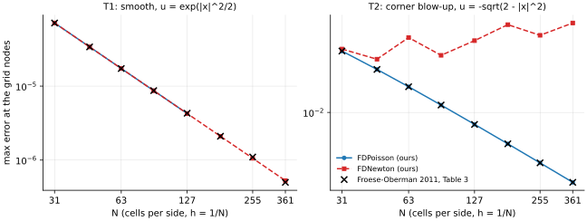

<div align="center">
  <h1>maesolvers</h1>
  <p><b>Solvers for the Monge-Amp&egrave;re equation, classical and neural, behind one interface and measured on one set of test problems.</b></p>
  <a href="https://github.com/jczhang02/maesolvers/actions/workflows/ci.yml"></a>
  <a href="LICENSE"></a>
  
  
</div>

<p align="center">
  
</p>

> maesolvers collects published methods for `det D^2 u = f`, reproduces the numbers their papers report, and runs them on a fixed catalogue of test problems so that methods can be compared on equal terms.
> It is alpha (0.1): `Problem`, `Result` and `evaluate` are frozen (ADR 0007), and the rest of the interface may still change in 0.x, never without a line in the [CHANGELOG](CHANGELOG.md); five finite-difference solvers and two neural solvers are in, and the [comparison table](#comparison) runs each of them on the shared test set.
> The figure above is the first reproduction: the standard-scheme column of Froese-Oberman 2011, Table 3, matched to the printed digits, and a Newton iteration on the same scheme that converges to the wrong root on the singular problem.

## Features

- **One interface**: a `Problem` (domain, right-hand side, a `Dirichlet` or `Transport` boundary condition, exact solution when known), a `Solver` whose `solve(problem) -> Result` runs one fixed lifecycle, and a `Result` that carries the solution as a callable plus, for grid methods, the nodes, values and discrete Hessian.
- **One catalogue**: `CATALOGUE` holds every test problem under the T id of the research programme's literature survey, the shared test set among them; an id is never reused, so tables from different methods line up.
- **Shared metrics**: `evaluate(result)` reports the max and RMS errors at the method's nodes (or on the shared grid for methods without nodes), the same errors on the shared grid, convexity statistics, cost and the problem's observables, the same way for every method; `summarize` aggregates seeds and counts failed ones.
- **Reproduction with receipts**: `benchmarks/` holds the published tables, our runs, the comparison and the script that draws it; a mismatch is recorded as a finding, not tuned away.
- **Configs and a command line**: `from_config` and `maesolvers solve` build any solver, nested parts included, from a dict, a YAML file or command-line arguments, read against the constructors' signatures.
- **Light dependencies**: numpy and scipy only; jsonargparse comes with the `cli` extra, and torch and lightning with the `neural` extra, which a neural solver needs only to solve.

## Quick Start

maesolvers is not on PyPI yet; install it from GitHub.

```sh
uv add git+https://github.com/jczhang02/maesolvers        # in a uv project
pip install git+https://github.com/jczhang02/maesolvers   # or with pip
```

Solve a catalogue problem and evaluate the result with the shared protocol.

```python
from maesolvers import T1, FDNewton
from maesolvers.metrics import evaluate

result = FDNewton(n=64).solve(T1)
for name, value in evaluate(result).items():
    print(f"{name}: {value:.4g}")
```

```text
max: 1.678e-05               # max error at the method's own nodes (the number papers print)
rms: 9.269e-06               # RMS error at the nodes
max_grid: 1.678e-05          # the same two errors on the shared 201 x 201 grid, a secondary value
rms_grid: 9.366e-06
nonconvex_fraction: 0        # share of interior nodes with a negative Hessian eigenvalue
eigmin: 1                    # smallest eigenvalue of the discrete Hessian there
eigmin_exact: 1              # and of the exact solution's Hessian at the same nodes
time: 0.05124                # seconds, varies from run to run
iterations: 4
unknowns: 3969
```

`evaluate` returns a dict, so `print(evaluate(result))` shows the same values at full precision.

The same solver comes from keyword arguments, from a dict or YAML file, or from the command line (ADR 0005); the last two need the `cli` extra (`pip install "maesolvers[cli] @ git+https://github.com/jczhang02/maesolvers"`).
A solver configuration names the solver by its `class_path` with its `init_args`, nested parts in the same form; it is the form `Result.hparams` records.

```yaml
# newton.yaml
class_path: Newton
init_args:
  scheme:
    class_path: Standard9
    init_args: {n: 64}
```

```python
from maesolvers import T2, from_config

solver = from_config("newton.yaml")  # Newton(scheme=Standard9(n=64))
result = solver.solve(T2)
rerun = from_config(result.hparams).solve(result.problem)  # any result reruns
```

On the command line, a configuration file holds the solver under `solver` and the problem's T id under `problem`.

```yaml
# exp.yaml
solver:
  class_path: Newton
  init_args:
    scheme:
      class_path: Standard9
      init_args: {n: 64}
problem: T2
```

```sh
maesolvers solve --config exp.yaml --solver.scheme.n 128 --problem T1 --output t1.json
maesolvers solve --solver FDNewton --solver.n 64 --problem T1
maesolvers solve --solver.help Newton  # the parameters of a solver
```

A `class_path` is the name of a class maesolvers ships or the dotted import path of any class, a solver of your own included, and a misspelt key is an error.
An argument after `--config` overrides the file, and `--print_config` writes a file that `--config` reads back.
`maesolvers solve` prints `evaluate` as a table, and `--output` writes the metrics, `Result.info` and, under `run`, a `--config` file that reruns the result, as strict JSON (NaN and infinity as `null`).

A new method subclasses `Solver` (or `IterativeSolver`) and writes the hooks `setup`, `run` (or `initial_guess`, `step`, `converged`) and `finalize`; the base class times the solve, calls the callbacks, records the hyperparameters and builds the `Result`, so the method is one class away from the comparison table.
The subclass carries its own `@dataclass(frozen=True, kw_only=True)` decorator (an inherited one does not count, and construction fails without it), declares `domains` and `boundaries` (and `measure` for an `IterativeSolver`), and every hook after `setup` takes the problem and the context first.

```python
from dataclasses import dataclass
from typing import ClassVar

from maesolvers import Box, Dirichlet, IterativeSolver, Solution


@dataclass(frozen=True, kw_only=True)
class MySolver(IterativeSolver):
    domains: ClassVar = (Box,)
    boundaries: ClassVar = (Dirichlet,)
    measure: ClassVar = "residual"  # the key of the per-step metrics

    n: int = 64  # a hyperparameter, recorded in Result.hparams
    tol: float = 1e-10

    def setup(self, problem): ...  # grid, operators: the context
    def initial_guess(self, problem, context): ...  # the first iterate
    def step(self, problem, context, iterate): ...  # (next iterate, measure), or None
    def converged(self, problem, context, measure):
        return measure <= self.tol

    def finalize(self, problem, context, state):
        return Solution(u=..., nodes=..., values=...)
```

[`docs/guide.md`](docs/guide.md) walks through solving, the three ways to pass parameters, and a complete solver of your own, with a new iteration and a new scheme as smaller plug-in points; a test runs every block of it.

## Test problems

`maesolvers.catalogue` defines every problem, `CATALOGUE` maps each T id to it, and each is also importable by name (`from maesolvers import T1`).
The ids are those of the research programme's literature survey; the P1 to P5 of 0.0.x are retired (P4 is T1, P5 is T2, P1 is T8 with `g = 0`, P3 is T12).
`SHARED_TEST_SET` lists the rows of the comparison table: T1, T2, T20, T8, T12, T9, T10.
Every Dirichlet problem with an exact solution takes its boundary data from it; `x0 = (0.5, 0.5)`.

| Id | Domain | `f` | Boundary | Exact solution | Tests |
|---|---|---|---|---|---|
| T1 | `(0, 1)^2` | `(1 + \|x\|^2) exp(\|x\|^2)` | Dirichlet | `exp(\|x\|^2 / 2)` | smooth, the standard finite-difference example |
| T2 | `(0, 1)^2` | `2 (2 - \|x\|^2)^-2` | Dirichlet | `-sqrt(2 - \|x\|^2)` | gradient blow-up at the corner `(1, 1)` |
| T3 | `(0, 1)^2` | `\|x\|^-1` | Dirichlet | `(2 sqrt 2 / 3) \|x\|^(3/2)` | `f` blows up at `(0, 0)` but is integrable |
| T4 | `(0, 1)^2` | 1 for `\|x - x0\| > 0.4`, else 0 | Dirichlet | 0.08 for `r <= 0.4`, `0.08 + (r s - 0.16 ln((r + s) / 0.4)) / 2` beyond, `r = \|x - x0\|`, `s = sqrt(r^2 - 0.16)` | discontinuous `f`, C^1 Alexandrov solution (not the source paper's `u`, see its note) |
| T5 | `(0, 1.5)^2` | 4 for `\|x\| > 1`, else 0 | Dirichlet | 0 for `r <= 1`, `r sqrt(r^2 - 1) - ln(r + sqrt(r^2 - 1))` beyond | discontinuous `f`, C^1 Alexandrov solution |
| T6 | quarter of the unit disk cut by `y > x - 1/2` (`CutQuarterDisk`) | from `u` | Dirichlet | `0.7 exp((x - 1/2)^2 / 2 + y^2) + x^2 - 1/2` | asymmetric domain |
| T7 | `[-1, 1]^2` | 1 | Dirichlet, `g = 1` | none; observable `u_origin`, `u(0, 0)` (compare at even `n`) | no classical solution at the corners |
| T8 | unit disk | 1 | Dirichlet, `g = 0` | `(\|x\|^2 - 1) / 2` | branch selection: the concave `(1 - \|x\|^2) / 2` also solves the equation |
| T9 | `(0, 1)^3` | `(1 + \|x\|^2) exp(3 \|x\|^2 / 2)` | Dirichlet | `exp(\|x\|^2 / 2)` | T1 in 3D |
| T10 | `(0, 1)^4` | `(1 + \|x\|^2) exp(2 \|x\|^2)` | Dirichlet | `exp(\|x\|^2 / 2)` | T1 in 4D |
| T12 | unit disk | 1 | transport onto the ellipse centred at `(3.5, 0)` with semi-axes `(2, 0.5)` | `x1^2 + 3.5 x1 + x2^2 / 4` | transport boundary condition, linear map |
| T16 | `(-1/2, 1/2)^2` | from `q(z)` (Benamou-Froese-Oberman 2014) | transport onto the same square | `\|x\|^2 / 2 + 4 q(x1) q(x2)` | transport with an oscillating density |
| T20 | `(0, 1)^2` | `(1 - 0.2 / \|x - x0\|)^+` | Dirichlet | `((\|x - x0\| - 0.2)^+)^2 / 2` | C^1 solution, `f = 0` on a disk |
| T22 | `(0, 1)^3` | `3 (3 - \|x\|^2)^(-5/2)` | Dirichlet | `-sqrt(3 - \|x\|^2)` | T2 in 3D |

Each problem's `note` names its source paper.
T21, the cone `|x - x0|` with `f` a Dirac mass, is not in the catalogue: `Problem.f` is a function and cannot hold a measure.

## Solvers

| Solver | Method | Domains | Boundary | Convexity |
|---|---|---|---|---|
| `FDNewton` | standard 9-point finite differences, damped Newton from a Poisson start | `Box`; `Disk`, `Ellipse`, `CutQuarterDisk` through Shortley-Weller stencils | Dirichlet | none; on T2 it converges to a non-convex discrete root |
| `FDPoisson` | the same discretisation solved by the Poisson iteration (M2) of Benamou-Froese-Oberman 2010 | the same | Dirichlet | selects the convex branch in practice |
| `FDMonotone` | the monotone wide-stencil scheme of Froese-Oberman 2011 (9, 17 or 33 points in 2D; 19 points in 3D with `stencil=19`), semi-smooth Newton | `Box` with equal sides, in the stencil's dimension | Dirichlet | monotone; a root is convex along every stencil direction, though its centred Hessian is not where `f = 0` (T20) |
| `FDHybrid` | the hybrid scheme of Froese-Oberman 2011: the standard scheme where the data are regular, the monotone one near the boundary and where `f` is near 0 or infinite; Newton from the monotone root | `Box` with equal sides | Dirichlet | monotone near the possible singularities; the start puts Newton on the convex root |
| `FDFiltered` | the filtered scheme of Froese-Oberman 2013: the standard 9-point scheme where it nearly agrees with the monotone one, the monotone scheme where they differ; Newton with the paper's approximate Jacobian | `Box` with equal sides | Dirichlet | nearly monotone; where the filter keeps the standard scheme it shares its non-convex roots (T20); its damped Newton often stalls (`converged` False on T1, T2, T4, T5, T7 and T20 at `n = 64`, on the cone), where on T2 the paper's undamped step converges with 9 points at every printed `N` (#56) |
| `PenaltyMLP` | the penalty MLP of Nystrom-Vestberg 2023: a sigmoid MLP in the ansatz `G + D N`, trained by L-BFGS on the summed residual (needs the `neural` extra) | 2D `Box`, `Disk`, `CutQuarterDisk` | Dirichlet | a penalty on negative `u_xx`, `u_yy` at the collocation points |
| `DirichletICNN` | the input convex network of Nystrom-Vestberg 2023: a 5 x 10 softplus ICNN trained by dense BFGS (SciPy's) on the summed residual plus a boundary penalty (needs the `neural` extra) | `Box` in any dimension, `Disk`, `CutQuarterDisk` | Dirichlet | convex by construction (non-negative hidden weights, softplus) |

Each solver is a preset, a scheme under an iteration (ADR 0004): `FDPoisson(n=64)` is `PoissonIteration(scheme=Standard9(n=64))`, `FDNewton(n=64)` is `Newton(scheme=Standard9(n=64))`, `FDMonotone(n=64)` is `Newton(scheme=Monotone17(n=64), max_iter=200)`, `FDHybrid(n=64)` is `Newton(scheme=Hybrid(n=64), start=FDMonotone(n=64), max_iter=200)`, Newton from the root of `FDMonotone`, and `FDFiltered(n=64)` is `Newton(scheme=Filtered(accurate=Standard9(n=64), monotone=Monotone17(n=64)), max_iter=200)`, a scheme made of two schemes.
A new scheme subclasses `Scheme` as a frozen dataclass and runs under every iteration whose extra methods it provides (`Newton.requires`, `PoissonIteration.requires`), without a new solver class.
A new iteration subclasses `SchemeIteration` and writes only `initial_guess`, `step` and `converged`.
`maesolvers.SOLVERS` lists the presets by name.
[`docs/methods/standard9.md`](docs/methods/standard9.md) gives the mathematics, the source papers, the parameters and the known limits of the scheme and its two iterations, [`docs/methods/monotone17.md`](docs/methods/monotone17.md) those of the monotone scheme, [`docs/methods/hybrid.md`](docs/methods/hybrid.md) those of the hybrid scheme, [`docs/methods/filtered.md`](docs/methods/filtered.md) those of the filtered scheme.

A neural solver is a network, a loss, a sampler and an optimizer (ADR 0004) on one training loop, a Lightning `Trainer` in float64 (ADR 0008): `PenaltyMLP()` is `NeuralSolver(network=HardDirichlet(network=MLP()), loss=PenaltyLoss(), sampler=UniformSampler(), optimizer=LBFGS(), max_steps=5000)`.
A new part subclasses `Network`, `Loss`, `Sampler` or `Optimizer` from `maesolvers.neural` as a frozen dataclass; `docs/guide.md` writes one of each.
The `seed` fixes the collocation points and the initial network, and `evaluate` measures the trained network on the shared evaluation grid.
`DirichletICNN()` swaps the network for `ICNN()`, convex in its input by construction, the loss for `PenaltyLoss(convexity_weight=0, boundary_weight=100, equation_at_boundary=True)` and the optimizer for `BFGS()`, with `max_steps=10_000`.
[`docs/methods/penalty_mlp.md`](docs/methods/penalty_mlp.md) and [`docs/methods/icnn.md`](docs/methods/icnn.md) describe the two methods.

## Comparison

The comparison table runs every preset of `SOLVERS` with its defaults on the shared test set, measured by `evaluate` (ADR 0007); it carries no published numbers, which belong to the reproduction tables below.
The max error is the one that ranks methods; the non-convex fraction is the share of points with a negative smallest Hessian eigenvalue (the interior nodes for a classical preset, the shared grid for a neural one).
[`benchmarks/comparison.md`](benchmarks/comparison.md) states how the runs were made and what the table shows; `benchmarks/run_comparison.py` writes [`benchmarks/comparison.csv`](benchmarks/comparison.csv) on a100server, one row per run, and `just comparison-table` writes the tables below from it (a test checks that they are current).

<!-- comparison table: written by benchmarks/comparison.py, do not edit -->
**Max error at the primary points**

| Problem | `FDNewton` | `FDPoisson` | `FDMonotone` | `FDHybrid` | `FDFiltered` | `PenaltyMLP` | `DirichletICNN` |
|---|---|---|---|---|---|---|---|
| T1 | 5.28e-7 (361) | 5.28e-7 (361) | 4.40e-4 (361) | 1.57e-6 (361) | 9.68e-5 (361) \* | 7.06e-3 [4.57e-3, 1.66e-2], 9/10 | 5.14e-5 [2.02e-5, 1.93e-4], 10/10 |
| T2 | 2.22e-2 (361) | 5.41e-3 (361) | 3.26e-4 (361) | 4.18e-5 (361) | 1.34e-4 (361) \* | 1.21e-1 [7.46e-2, 1.88e-1], 0/10 | 8.31e-1 [5.64e-2, 1.20e3], 0/10 |
| T20 | 5.48e-5 (361) | 1.59e-5 (361) | 6.60e-4 (361) | 2.97e-5 (361) | 4.48e-5 (361) \* | 4.34e-3 [3.65e-3, 7.93e-3], 0/10 | 1.35e-2 [4.25e-3, 2.45e-2], 0/10 |
| T8 | 3.26e-13 (361) | 1.55e-12 (361) | not on a Disk | not on a Disk | not on a Disk | 5.04e-3 [3.90e-3, 8.96e-3], 5/10 | 6.61e-6 [2.88e-6, 1.22e-5], 10/10 |
| T12 | Dirichlet only | Dirichlet only | Dirichlet only | Dirichlet only | Dirichlet only | Dirichlet only | Dirichlet only |
| T9 | 2D only | 2D only | 2D stencil | 2D only | 2D only | 2D only | 1.22e-2 [4.14e-3, 1.04e3], 7/10 |
| T10 | 2D only | 2D only | 2D/3D only | 2D only | 2D only | 2D only | 9.09e2 [2.99e0, 4.46e4], 0/10 |

**Non-convex fraction**

| Problem | `FDNewton` | `FDPoisson` | `FDMonotone` | `FDHybrid` | `FDFiltered` | `PenaltyMLP` | `DirichletICNN` |
|---|---|---|---|---|---|---|---|
| T1 | 0 | 0 | 0 | 0 | 0 \* | 0.00124% | 0 |
| T2 | 1.09% | 0 | 0.00772% | 0.00772% | 0.00772% \* | 7.39% | 0 |
| T20 | 9.79% | 3.38% | 4.83% | 3.5% | 8.46% \* | 2.52% | 0 |
| T8 | 0 | 0 | not on a Disk | not on a Disk | not on a Disk | 0 | 0 |
| T12 | Dirichlet only | Dirichlet only | Dirichlet only | Dirichlet only | Dirichlet only | Dirichlet only | Dirichlet only |
| T9 | 2D only | 2D only | 2D stencil | 2D only | 2D only | 2D only | 0 |
| T10 | 2D only | 2D only | 2D/3D only | 2D only | 2D only | 2D only | 0 |

**Time in seconds**

| Problem | `FDNewton` | `FDPoisson` | `FDMonotone` | `FDHybrid` | `FDFiltered` | `PenaltyMLP` | `DirichletICNN` |
|---|---|---|---|---|---|---|---|
| T1 | 7.19 | 2.63 | 60.5 | 68.3 | 36.1 \* | 418 | 991 |
| T2 | 37.4 | 5.75 | 147 | 152 | 45 \* | 419 | 550 |
| T20 | 67.5 | 36.3 | 132 | 240 | 142 \* | 416 | 1009 |
| T8 | 2.98 | 3.9 | not on a Disk | not on a Disk | not on a Disk | 416 | 797 |
| T12 | Dirichlet only | Dirichlet only | Dirichlet only | Dirichlet only | Dirichlet only | Dirichlet only | Dirichlet only |
| T9 | 2D only | 2D only | 2D stencil | 2D only | 2D only | 2D only | 1450 |
| T10 | 2D only | 2D only | 2D/3D only | 2D only | 2D only | 2D only | 155 |

A classical cell is one run on the grid `n` in parentheses, the largest `N` of the papers, with `h = 1/n` on T1, T2 and T20, `h = 2/n` on T8 (ADR 0001), and its error at its own nodes; `\*` marks a run whose iteration stopped before its tolerance.
A neural cell is over seeds 0 to 9: the median, the 5% to 95% band and the number of seeds whose max error on the shared evaluation grid is below 1% of the exact solution's oscillation `max u - min u` there; a failed seed counts as an infinite error (ADR 0007).
The non-convex fraction and the time of a neural cell are medians over the seeds that did not fail.
Every run took 1 CPU thread and ran on the device `cpu`; CPU: Intel(R) Xeon(R) Platinum 8358 CPU @ 2.60GHz.
A cell with a reason marks a preset that does not support the problem: `not on a Disk` on T8; `Dirichlet only` on T12; `2D only` on T9 and T10; `2D stencil` on T9; `2D/3D only` on T10.
The roadmap's 0.2 gives the finite-difference presets transport boundary conditions (T12) and n-dimensional boxes (T9 and T10).
<!-- comparison table end -->

## Reproduction

A reproduction is judged against the source paper's own table, on the paper's own test problem, and its verdict is one of the five levels of ADR 0002: exact (the printed digits at every printed `N`), order of magnitude (ours / published in `[1/2, 2]` at every printed `N`, and convergence orders within 0.2), statistical (neural methods: the published number lies inside our 5% to 95% band over 10 seeds), figure only (the paper prints only a figure), or mismatch, recorded as a finding (`docs/adr/0002-reproduction-levels.md`).
`benchmarks/sources.md` transcribes the published tables with their conventions; `benchmarks/standard_fd.md` compares them with ours.

| Problem | N | Published | FDPoisson | FDNewton |
|---|---|---|---|---|
| T1 | 31 | 7.14e-5 | 7.144e-5 | 7.144e-5 |
| T1 | 361 | 0.05e-5 | | 5.276e-7 |
| T2 | 31 | 17.15e-3 | 17.15e-3 | 17.45e-3 |
| T2 | 361 | 5.41e-3 | 5.409e-3 | 22.25e-3 |
| T7 | 21 | 0.2892 | 0.2892 | 0.2892 |
| T7 | 141 | 0.2621 | 0.2621 | 0.3245 |

For T1 and T2 the values are max errors at the nodes (Froese-Oberman 2011, Table 3), with `N` cells per side.
For T7 they are `u_min`, the value at the origin (Benamou-Froese-Oberman 2010, Table 7), with `N` nodes per side, so `n = N - 1` cells.

Three things came out of this first comparison.
The papers' grid convention, which none of them states, is `h = 1/N`, except in the 2010 Table 7, where `N` counts nodes.
Newton on the standard scheme converges in the residual on T2 but to a non-convex discrete solution near the corner, so the literature's "standard scheme" numbers are the fixed point of the Poisson or Gauss-Seidel iteration, not of Newton.
On T7 Newton does the same from `N = 41` on, while the Poisson iteration matches the 2010 table at every printed `N`.

The monotone wide-stencil scheme (`FDMonotone`) matches the 9-, 17- and 33-point columns of Froese-Oberman 2011 (SIAM J. Numer. Anal.), Table 3, on T2 at every printed `N` and on T1 from `N = 127` on; at coarse grids, on T20 and on the cone T21 the published errors differ from ours, and [`benchmarks/monotone17.md`](benchmarks/monotone17.md) records why as findings.
In 3D its 19-point stencil (`FDMonotone(stencil=19)`) reaches the order-of-magnitude level of the same paper's Table 4 on T9 and, depending on the grid convention, on T22 or the `C^1` example, with T9 exact at three of the five printed `N`; the paper's `N` fits neither grid convention everywhere, and on the `C^1` example its errors stay below ours ([`benchmarks/monotone19.md`](benchmarks/monotone19.md)).

The hybrid scheme (`FDHybrid`) matches the column "Hybrid" of Froese-Oberman 2011 (J. Comput. Phys.), Table 3, on T2 from `N = 127` on, and at every printed `N` with `h = 1/(N - 1)`; it needs a convex start, which `FDHybrid` takes from the monotone scheme, since Newton from the Poisson start reaches a non-convex root on T2.
On T1 and T20 the published errors are above ours, and [`benchmarks/hybrid.md`](benchmarks/hybrid.md) records the findings.

The filtered scheme (`FDFiltered`) matches Froese-Oberman 2013, Table 4.2, on its centred smooth example at every printed `N`, with `N` nodes per side; on T2 the preset's damped Newton stalls, while the paper's undamped Newton step on the same scheme makes the 9-point column of its Table 4.1 exact; the 17- and 33-point columns and Table 4.2's filtered column are a mismatch, because neither iteration converges there from `N = 127`; on T20 `FDFiltered` reaches a non-convex root of the standard scheme, so T20 and the cone are a mismatch ([`benchmarks/filtered.md`](benchmarks/filtered.md)).

The penalty MLP of Nystrom-Vestberg 2023 reaches the figure-only level of ADR 0002 on T1: over seeds 0 to 9 its max error is 7.1e-3 (5% to 95%: 4.6e-3 to 1.7e-2), and Figure 1 of the paper tops at about 5.7e-3.
The paper prints no table for it: its Tables 1 to 3 belong to its input convex network (`benchmarks/penalty_mlp.md`, Finding 1).
The input convex network of the same paper (`DirichletICNN`) reaches the figure-only level on T1: its max error is 5.1e-5 (5% to 95%: 2.0e-5 to 1.9e-4), against about 3.0e-5 in Figure 2; it needs the dense BFGS of SciPy, which the paper ran, and on T1 a limited-memory L-BFGS leaves it near 1e-2.
On T6 it is a mismatch: 1.1e-4 (5.5e-5 to 2.4e-4) at 10^6 random points against 8.58e-6 in Table 1.
The equation term, which the paper prints as a sum, explains part of the gap: read as a mean, it gives 3.1e-5 (1.2e-5 to 5.0e-5) and meets the paper's stopping test, but is still a mismatch; the preset waits for #13 to choose (`benchmarks/icnn.md`, Finding 2).

<details>
<summary><strong>Redraw the figure</strong></summary>

```sh
uv run benchmarks/plot_standard_fd.py     # reads the CSVs next to it, writes standard_fd.svg
```

</details>

## Roadmap

A method enters the library when it can be implemented from its paper and fits `Problem -> Result`; methods without an error table are included and marked as such.
The order puts first the methods the literature uses most, those that share infrastructure, and those with tables to reproduce.
The design behind 0.1 is recorded in `docs/adr/`.

- **0.0.2**, done. The solver lifecycle, composition and configuration of ADR 0003 to 0005, the frozen `Problem`, `Result` and `evaluate` of ADR 0007, and the catalogue under the T ids of the shared test set; the two existing solvers move over with their reproduction intact.
- **0.1**, done (the ICNN loss reading waits for #13). Finite differences: Shortley-Weller boundaries for the standard 9-point scheme (so T8 runs on the disk), the monotone 17-point scheme (Froese-Oberman 2011), the filtered scheme (Froese-Oberman 2013), the hybrid scheme (Froese-Oberman 2011); neural: the shared training loop (ADR 0008) with the penalty MLP (Nystrom 2023) and ICNN; the comparison table generated from the runs.
- **0.2**: n-dimensional boxes and the 19-point monotone scheme, transport boundary conditions (Benamou-Froese-Oberman 2014, Caboussat-Peruso 2025), a multigrid option, the semi-Lagrangian scheme, QS-PINN.
- **0.3**: finite elements through scikit-fem (Feng-Neilan, Brenner-Neilan C0 interior penalty, Awanou splines, two-scale, Dean-Glowinski least-squares and augmented Lagrangian).
- **0.4**: Oliker-Prussner, MA-LBR, Froese 2017 point clouds, C-PINN, KAN, Deep Ritz splitting.

Out of scope, because `Problem -> Result` cannot hold them: semi-discrete and sample-based optimal transport, parabolic formulations.

## Layout

- `src/maesolvers/core/`: `Problem`, the domains and boundary conditions, `Result`, the `Solver` lifecycle and `IterativeSolver`, callbacks, the parameter checks `integer`, `positive`, `nonnegative` and `boolean`, and the part check `check_part`.
- `src/maesolvers/classical/`: the schemes `Standard9`, `Monotone17` (2D, and 3D with 19 points), `Hybrid` and `Filtered`, the iterations `Newton` and `PoissonIteration`, the presets `FDNewton`, `FDPoisson`, `FDMonotone`, `FDHybrid` and `FDFiltered`, and `BoxGrid`, the grid of `n` cells per side over a box in any dimension, with its stencils and its tensor spline (`grid.py`).
- `src/maesolvers/neural/`: `NeuralSolver` and its parts (networks, losses, samplers, optimizers), the torch kernels in `functional.py`, the Lightning training loop, and the presets `PenaltyMLP` and `DirichletICNN`.
- `src/maesolvers/catalogue.py`: the test problems under their T ids; `metrics.py`: `evaluate` and `summarize`; `registry.py`: `SOLVERS`.
- `src/maesolvers/config.py` and `cli.py`: `from_config` and `maesolvers solve` (the `cli` extra); `tracking.py`: MLflow runs and `MLflowLogger`.
- `benchmarks/`: the published tables, our runs, the comparisons and the scripts that make them, and the comparison table's CSV (`comparison.csv`) with its runner and renderer.
- `docs/guide.md`: the user guide; `docs/methods/`: one page per method, or per scheme with its iterations (`standard9.md`); `docs/adr/`: the design decisions; `GLOSSARY.md`: the terms.
- `tests/`: the tests, among them the reproduction pins (`test_reproduction.py`) and the guide's code blocks (`test_guide.py`).

## Development

```sh
uv sync --group dev
just check   # ruff format and lint, pyright on src/, pytest without extras, then with every extra (torch on CPU)
just fmt     # format and fix
```

CI runs the same checks on Python 3.10 and 3.13, and its job without extras also checks that the package imports with numpy and scipy alone.
The pytest marker `neural` marks the tests that need the `neural` extra; CI runs them on CPU, with torch from the PyTorch CPU index (the `neural-cpu` dependency group), so no CUDA wheel is downloaded.
Tests check every catalogue problem against the point values of the shared test-set specification and against its own equation, that the solvers converge at the expected order, and that the published numbers above still match.

## License

MIT; see [LICENSE](LICENSE).
